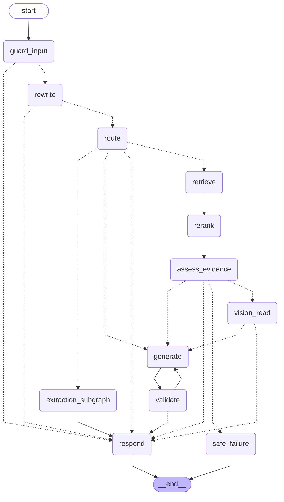
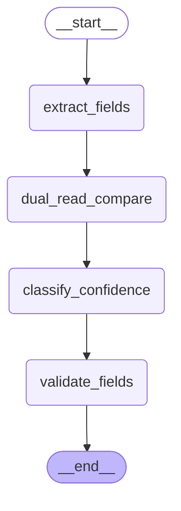

# LangGraph Query Flow & Extraction Subgraph Topology

Automated Mermaid diagram generated by `scripts/generate_graph_docs.py`.
Verified by contract tests in `backend/tests/unit/test_graph_contracts.py`.

## 1. 9-Node Knowledge Query StateGraph

## 2. Dedicated Extraction Subgraph

